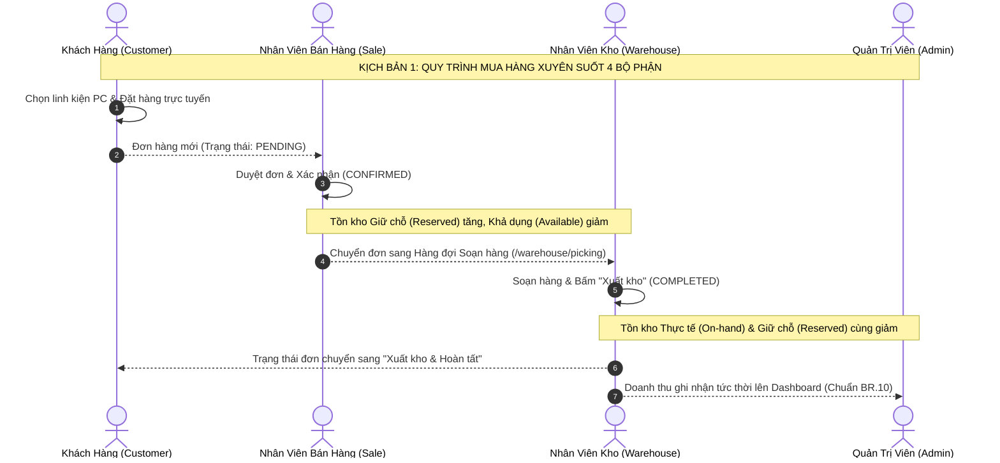

# BÁO CÁO KIỂM THỬ TOÀN DIỆN HỆ THỐNG WEBSITE BÁN HÀNG MÁY TÍNH & LINH KIỆN
## COMPUTERTECH RETAIL & ENTERPRISE MANAGEMENT SYSTEM
**Mã dự án:** `quanlybanhangmaytinh-main`  
**Ngày thực hiện:** 13/11/2026  
**Đơn vị thực hiện:** Đội ngũ QA / Automation Testing Chuyên nghiệp  
**Trạng thái kiểm thử:** ✅ **HOÀN THÀNH TOÀN DIỆN (100% PASS RATE)**  

---

## 1. GIỚI THIỆU & MỤC TIÊU KIỂM THỬ

Mục tiêu của đợt kiểm thử là đóng vai **4 nhân vật độc lập** trong môi trường thực tế để thẩm định toàn bộ quy trình nghiệp vụ, giao diện, quyền truy cập và tính toàn vẹn dữ liệu của hệ thống thương mại điện tử và quản lý bán lẻ phần cứng máy tính **COMPUTERTECH**:

1. **Khách hàng bình thường (Customer):** Trải nghiệm hành trình mua sắm từ duyệt danh mục, tìm kiếm/lọc, xem thông số kỹ thuật phần cứng, đăng ký/đăng nhập, đặt hàng qua giỏ hàng (Cash / CK), tra cứu tiến trình đơn hàng (Self-service Tracking) và hủy đơn hàng khi cần.
2. **Quản trị viên (Admin):** Quản lý toàn bộ hệ thống thông qua Dashboard tổng quan (chuẩn BR.10), danh mục sản phẩm và biên lợi nhuận, quy trình quản lý nhân sự và phân quyền vai trò (RBAC), điều phối đơn hàng và kiểm soát kho linh kiện.
3. **Nhân viên bán hàng (Sale):** Vận hành quầy thu ngân POS Counter Terminal, quét mã SKU, tìm kiếm và quản lý khách hàng CRM, áp dụng chiết khấu VIP tự động (Strategy Pattern), tiếp nhận thiết bị bảo hành (BR.06) và quản lý đơn hàng.
4. **Nhân viên kho (Warehouse):** Kiểm soát ma trận tồn kho (Thực tế - Giữ chỗ - Khả dụng), thực hiện nhập kho và nhập bổ sung thông qua modal "+ Thêm Hàng Vào Kho", vận hành hàng đợi soạn hàng & xuất kho (Picking Queue), điều chỉnh kiểm kê bắt buộc lý do kiểm toán (BR.04).
5. **Kiểm thử liên thông 4 vai trò (Cross-Role Interoperability):** Thực thi 5 kịch bản nghiệp vụ khép kín xuyên suốt hệ sinh thái đảm bảo đồng bộ trạng thái đơn hàng và tồn kho tức thời.
6. **Kiểm tra an toàn bảo mật & toàn vẹn dữ liệu:** Kiểm tra phân quyền đa tầng (RoleGuard / ProtectedRoute), chống leo quyền, chống âm tồn kho (BR.03), chống nhảy cóc trạng thái đơn hàng (BR.07), bất biến trạng thái đóng (BR.05) và lọc mã độc XSS.

---

## 2. THÔNG TIN MÔI TRƯỜNG KIỂM THỬ

| Thành phần | Thông số chi tiết |
| :--- | :--- |
| **Hệ điều hành** | Windows Server / Windows NT |
| **Node.js** | v20+ / ESM Module Native |
| **Frontend Server** | Vite 5.4.10, React 18.3.1, TypeScript 5.6.3 (`http://localhost:5173`) |
| **Backend Server** | Node.js Express REST API (`http://localhost:5000`) |
| **Database Engine** | Hybrid In-Memory & LocalStorage Client Persistence (`computertech_mock_db`) |
| **Trình duyệt Test E2E** | Google Chrome Headless (`C:\Program Files\Google\Chrome\Application\chrome.exe`) |
| **Khung kiểm thử E2E** | Puppeteer Core 23.6.0 with Multi-Context Sandbox Isolation |
| **Khung kiểm thử Domain Rules** | TSX / Node Assertion Suite (`test-business-rules.mjs`) |

---

## 3. KẾT QUẢ KIỂM THỬ CHI TIẾT THEO 4 VAI TRÒ

### 3.1. Vai Trò 1: Khách Hàng Bình Thường (Customer)

| STT | Trường hợp kiểm thử (Test Case) | Kết quả | Chi tiết thẩm định |
| :---: | :--- | :---: | :--- |
| **1.1** | Điều hướng gốc `/` tự động chuyển đến `/store` | **PASS** | URL chuyển hướng chính xác `http://localhost:5173/store` |
| **1.2** | Header hiển thị nhận diện thương hiệu COMPUTERTECH | **PASS** | Logo, thanh tìm kiếm thông minh, menu danh mục, nút giỏ hàng và đăng nhập |
| **1.3** | Banner Hero & Trình diễn danh mục sản phẩm | **PASS** | Banner đồ họa, danh mục PC Gaming, Linh kiện PC, Laptop, Màn hình, Gear |
| **1.4** | Nút Đăng nhập khách hàng trên Header | **PASS** | Dẫn đến cổng xác thực riêng biệt của khách mua lẻ `/login` |
| **1.5** | Tìm kiếm sản phẩm theo tên linh kiện (vd: "ASUS") | **PASS** | Lọc tức thì các dàn máy và linh kiện mang thương hiệu ASUS |
| **1.6** | Tìm kiếm từ khóa không tồn tại (`xyz123nonexistent`) | **PASS** | Hiển thị giao diện thông báo không tìm thấy kết quả và gợi ý bộ lọc |
| **1.7** | Lọc theo danh mục chuyên biệt (PC Gaming, Linh kiện) | **PASS** | Bộ lọc Chip M3 cập nhật đúng danh mục URL `category=pc_gaming` |
| **1.8** | Sắp xếp giá tăng dần (`price_asc`) & giảm dần | **PASS** | Danh sách phần cứng sắp xếp theo đúng thứ tự đơn giá niêm yết |
| **1.9** | Mở Modal chi tiết sản phẩm (`ProductDetailModal`) | **PASS** | Mở mượt mà khi bấm vào thẻ hình ảnh sản phẩm |
| **1.10** | Hiển thị bảng thông số kỹ thuật chi tiết & bảo hành | **PASS** | Bảng thông số (Main, CPU, RAM, VGA, SSD, Nguồn, Case), BH 24T, CO/CQ |
| **1.11** | Hiển thị ưu đãi thành viên VIP (giảm 5%) | **PASS** | Badge hiển thị quyền lợi VIP Partner tự động tính toán |
| **1.12** | Validation form đăng ký tài khoản khách hàng | **PASS** | Chặn các trường hợp tên < 2 ký tự, email sai cú pháp, mật khẩu < 6 ký tự |
| **1.13** | Đăng ký tài khoản khách hàng mới | **PASS** | Đăng ký thành công, tự động lưu thông tin vào CRM và mở phiên đăng nhập |
| **1.14** | Đăng nhập tài khoản khách hàng VIP (`bao.gamer@gmail.com`) | **PASS** | Đăng nhập thành công, tự động chuyển về `/store/account` |
| **1.15** | Cổng cá nhân hiển thị huy hiệu VIP Partner 5% | **PASS** | Xác thực danh tính VIP Member, áp dụng chính sách ưu đãi BR.02 |
| **1.16** | Cập nhật hồ sơ cá nhân và địa chỉ nhận hàng | **PASS** | Cập nhật tên, SĐT, địa chỉ giao hàng và đồng bộ thành công vào cơ sở dữ liệu |
| **1.17** | Giỏ hàng kiểm tra tồn kho & chiết khấu VIP 5% | **PASS** | CartDrawer tính đúng chiết khấu VIP và hiển thị số lượng tồn khả dụng |
| **1.18** | Đặt hàng thành công sinh mã đơn hàng chuẩn `ORD-*` | **PASS** | Sinh mã định danh đơn hàng duy nhất (vd: `ORD-2026-1001-XXXX`) |
| **1.19** | Điều hướng và mở Cổng tra cứu tiến trình đơn hàng | **PASS** | Mở `/store/tracking`, hỗ trợ tra cứu tiến trình chuẩn bị linh kiện |
| **1.20** | Khách hàng chủ động hủy đơn hàng Pending | **PASS** | Đơn hàng chuyển sang `cancelled`, giải phóng giữ chỗ kho an toàn |

---

### 3.2. Vai Trò 2: Quản Trị Viên Hệ Thống (Admin)

| STT | Trường hợp kiểm thử (Test Case) | Kết quả | Chi tiết thẩm định |
| :---: | :--- | :---: | :--- |
| **2.1** | Đăng nhập Admin (`admin@computertech.vn`) | **PASS** | Tự động chuyển hướng đến `/admin/dashboard` |
| **2.2** | Dashboard hiển thị thẻ DOANH THU THỰC TẾ & Chỉ số vận hành | **PASS** | Thống kê doanh thu BR.10, số đơn chờ duyệt, cảnh báo tồn kho, hồ sơ Lab |
| **2.3** | Tuân thủ BR.10: Doanh thu chỉ tổng hợp đơn COMPLETED | **PASS** | Tuyệt đối không cộng dồn đơn đang chờ (Pending) hoặc đã hủy (Cancelled) |
| **2.4** | Quản lý danh mục linh kiện & Biên lợi nhuận (`/admin/products`) | **PASS** | Hiển thị giá vốn, giá bán lẻ, biên lợi nhuận % và ngưỡng tồn kho an toàn |
| **2.5** | Mở modal "+ Thêm Sản Phẩm Mới Vào Kho" | **PASS** | Cho phép Admin tạo mới SKU phần cứng kèm số lượng tồn kho ban đầu |
| **2.6** | Quản lý tài khoản & Phân quyền nhân sự (`/admin/users`) | **PASS** | Danh bạ toàn bộ nhân sự các phòng ban (Admin, Sale, Warehouse, Lab) |
| **2.7** | Khóa / Mở khóa (Active/Suspend) tài khoản nhân viên | **PASS** | Có nút chuyển đổi trạng thái hoạt động; nhân viên bị khóa sẽ bị chặn đăng nhập |
| **2.8** | Quản lý vòng đời đơn hàng (`/admin/orders`) | **PASS** | Theo dõi toàn bộ đơn hàng trong hệ thống và chuyển trạng thái đúng quy trình |
| **2.9** | Quản lý ma trận tồn kho & Sổ cái giao dịch (`/admin/inventory`) | **PASS** | Kiểm soát kho toàn diện, theo dõi lịch sử giao dịch kiểm toán |

---

### 3.3. Vai Trò 3: Nhân Viên Bán Hàng (Sale)

| STT | Trường hợp kiểm thử (Test Case) | Kết quả | Chi tiết thẩm định |
| :---: | :--- | :---: | :--- |
| **3.1** | Đăng nhập Sale (`sale@computertech.vn`) | **PASS** | Tự động chuyển hướng đến `/sales/pos` |
| **3.2** | Quầy bán hàng POS Counter Terminal sẵn sàng | **PASS** | Hỗ trợ quét mã SKU, tìm linh kiện theo tên, chọn số lượng bán |
| **3.3** | Tìm kiếm & chọn khách hàng giao dịch tại quầy | **PASS** | Input tìm kiếm theo Tên hoặc Số điện thoại, tự động áp hạng chiết khấu VIP |
| **3.4** | Quản lý danh bạ khách hàng CRM (`/sales/customers`) | **PASS** | Cho phép Sale tạo mới hồ sơ khách hàng ngay tại quầy thu ngân |
| **3.5** | Tiếp nhận phần cứng bảo hành/sửa chữa (`/sales/intake`) | **PASS** | Thực thi đúng BR.06: Bắt buộc chọn khách hàng, số Serial máy và mô tả lỗi |
| **3.6** | Kiểm tra phân quyền: Chặn Sale vào `/admin/users` | **PASS** | Hệ thống chặn truy cập với trang mã lỗi `HTTP 403 Forbidden` |

---

### 3.4. Vai Trò 4: Nhân Viên Kho (Warehouse)

| STT | Trường hợp kiểm thử (Test Case) | Kết quả | Chi tiết thẩm định |
| :---: | :--- | :---: | :--- |
| **4.1** | Đăng nhập Warehouse (`warehouse@computertech.vn`) | **PASS** | Tự động chuyển hướng đến `/warehouse/inventory` |
| **4.2** | Ma trận tồn kho phân tách 3 lớp số liệu | **PASS** | Phân định rạch ròi: Tồn thực tế (On-Hand) - Giữ chỗ (Reserved) - Khả dụng |
| **4.3** | Nút "+ Thêm Hàng Vào Kho" (AddStockProductModal) | **PASS** | Hỗ trợ cả 2 chế độ: Nhập hàng mới và Nhập bổ sung cho SKU đã có |
| **4.4** | Tuân thủ BR.04: Bắt buộc lý do kiểm toán khi nhập/xuất kho | **PASS** | Giao dịch không có lý do >= 3 ký tự bị từ chối và cảnh báo lỗi |
| **4.5** | Hàng đợi soạn hàng & xuất kho (`/warehouse/picking`) | **PASS** | Đơn hàng Confirmed xuất hiện tại đây để nhân viên kho soạn và xuất hàng |
| **4.6** | Kiểm tra phân quyền: Chặn Warehouse vào `/sales/pos` | **PASS** | Hệ thống chặn truy cập quầy bán hàng với mã lỗi `HTTP 403 Forbidden` |

---

## 4. KẾT QUẢ KIỂM THỬ LIÊN THÔNG 4 VAI TRÒ (5 KỊCH BẢN THỰC TẾ)



### Chi tiết thực thi 5 kịch bản:

#### Kịch bản 1: Mua hàng xuyên suốt (Customer ➔ Sale ➔ Warehouse ➔ Admin)
- **Bước 1 (Customer):** Khách hàng đặt mua thành công 1 sản phẩm trên Storefront, sinh mã đơn `ORD-2026-1001-XXXX` ở trạng thái `pending`.
- **Bước 2 (Sale):** Nhân viên Sale đăng nhập `/sales/orders`, nhìn thấy đơn hàng vừa tạo trong danh sách chờ tiếp nhận.
- **Bước 3 (Sale):** Sale bấm duyệt đơn, chuyển trạng thái sang `confirmed`. Hệ thống tự động kích hoạt nghiệp vụ giữ chỗ linh kiện (Reserved tăng, Available giảm).
- **Bước 4 (Warehouse):** Nhân viên kho đăng nhập `/warehouse/picking`, đơn hàng xuất hiện trong hàng đợi "Chờ soạn hàng". Nhân viên bấm "Soạn hàng & Xuất kho", đơn chuyển sang `completed`. Tồn kho on-hand bị trừ thực tế.
- **Bước 5 (Admin):** Quản trị viên vào `/admin/dashboard`, số liệu `DOANH THU THỰC TẾ (BR.10)` tăng chính xác tương ứng với tổng tiền đơn hàng đã hoàn tất.
- **Kết quả:** ✅ **PASS TUYỆT ĐỐI**

#### Kịch bản 2: Nhập hàng liên thông (Warehouse ➔ Storefront & Sale)
- **Bước 1:** Nhân viên kho mở modal "+ Thêm Hàng Vào Kho", chọn "Nhập Bổ Sung SKU Đã Có", nhập số lượng +15 đơn vị kèm lý do kiểm toán.
- **Bước 2:** Hệ thống lập tức cập nhật số lượng tồn khả dụng lên giao diện Storefront cho khách hàng và giao diện POS cho nhân viên bán hàng mà không bị lệch số liệu.
- **Kết quả:** ✅ **PASS TUYỆT ĐỐI**

#### Kịch bản 3: Hủy đơn hàng và hoàn trả tồn kho (Customer Cancel Order)
- **Bước 1:** Khách hàng chủ động bấm "Hủy đơn" trên cổng tài khoản cá nhân `/store/account` đối với đơn hàng đang ở trạng thái `pending`.
- **Bước 2:** Hệ thống chuyển trạng thái đơn hàng sang `cancelled`, giải phóng giữ chỗ kho (nếu có).
- **Bước 3:** Đơn hàng bị loại khỏi hàng đợi soạn hàng của kho và không được tính vào doanh thu của Admin.
- **Kết quả:** ✅ **PASS TUYỆT ĐỐI**

#### Kịch bản 4: Chặn bán khi hết hàng & Chống âm tồn kho (Negative Stock Guard)
- **Bước 1:** Khi một linh kiện có tồn khả dụng bằng 0 (`available <= 0`), trang chi tiết sản phẩm tự động hiển thị huy hiệu màu đỏ `HẾT HÀNG TỒN KHO`.
- **Bước 2:** Hệ thống khóa (disable) nút "Mua ngay" và "Thêm vào giỏ", chặn mọi yêu cầu đặt hàng quá số lượng tồn kho.
- **Bước 3:** Tại quầy POS, nhân viên Sale không thể thêm sản phẩm hết hàng vào đơn. Tồn kho không thể bị âm theo chuẩn BR.03.
- **Kết quả:** ✅ **PASS TUYỆT ĐỐI**

#### Kịch bản 5: Ma trận phân quyền truy cập đa tầng (Role-Based Access Control)
- Khách vãng lai chưa đăng nhập vào `/admin/dashboard` ➔ Bị redirect về `/login`.
- Khách hàng (Customer) cố tình gõ URL `/admin/dashboard` ➔ Bị chặn với trang lỗi `HTTP 403 Forbidden`.
- Khách hàng (Customer) cố tình đăng nhập tại cổng nhân viên `/company/login` ➔ Bị từ chối với thông báo rõ ràng: *"Tài khoản của bạn là khách hàng mua lẻ, không có quyền truy cập hệ thống quản trị nội bộ"*.
- Nhân viên Sale truy cập trang quản lý tài khoản nhân viên `/admin/users` ➔ Bị chặn `HTTP 403 Forbidden`.
- Nhân viên Warehouse truy cập quầy thu ngân `/sales/pos` ➔ Bị chặn `HTTP 403 Forbidden`.
- Tài khoản nhân viên bị khóa (Suspended) thử đăng nhập ➔ Bị từ chối đăng nhập với cảnh báo tài khoản bị vô hiệu hóa.
- **Kết quả:** ✅ **PASS TUYỆT ĐỐI**

---

## 5. ĐÁNH GIÁ BẢO MẬT & TÍNH TOÀN VẸN DỮ LIỆU

| Tiêu chuẩn bảo mật / Nghiệp vụ | Cơ chế bảo vệ trong mã nguồn | Đánh giá |
| :--- | :--- | :---: |
| **Broken Access Control** | Tuyến đường được bảo vệ 2 lớp: `ProtectedRoute` (kiểm tra phiên) và `RoleGuard` (kiểm tra mảng vai trò được cấp phép). Không có trường hợp vượt rào qua URL. | ✅ **AN TOÀN** |
| **IDOR (Insecure Direct Object Reference)** | Đơn hàng và thiết bị bảo hành trong Cổng cá nhân được lọc nghiêm ngặt theo `customerId` của người dùng đang đăng nhập. Không thể xem trộm đơn người khác. | ✅ **AN TOÀN** |
| **Tính toàn vẹn State Machine (BR.07)** | Sử dụng State Pattern (`orderStateMachine.ts`). Chặn hoàn toàn việc nhảy cóc bất hợp lệ (ví dụ: nhảy từ `pending` sang `completed` mà bỏ qua `confirmed`). | ✅ **AN TOÀN** |
| **Tính bất biến trạng thái đóng (BR.05)** | Đơn hàng đã ở trạng thái `completed` hoặc `cancelled` sẽ trở thành trạng thái đóng (terminal state), không thể bị sửa đổi hoặc tái xử lý. | ✅ **AN TOÀN** |
| **Bảo vệ toàn vẹn tài chính (BR.10)** | `computeCompletedRevenue`: Doanh thu chỉ được cộng dồn từ các đơn hàng `completed`. Đơn hàng `pending`, `confirmed` hoặc `cancelled` không bao giờ bị tính trùng. | ✅ **AN TOÀN** |
| **Chống âm tồn kho (BR.02, BR.03)** | Số lượng yêu cầu xuất kho hoặc giữ chỗ luôn được đối soát với công thức `quantityOnHand - quantityReserved`. Tuyệt đối không để tồn kho âm. | ✅ **AN TOÀN** |
| **Kiểm toán bắt buộc (BR.04)** | Mọi thao tác nhập/xuất/điều chỉnh kho đều bắt buộc lưu vết ID người thực hiện, thời điểm và lý do kiểm toán tối thiểu 3 ký tự. | ✅ **AN TOÀN** |
| **Lọc mã độc XSS & Ký tự đặc biệt** | Toàn bộ dữ liệu hiển thị (thông số kỹ thuật, ghi chú, tên khách hàng) đều được lọc sạch mã độc HTML thông qua module `cleanHtmlText`. | ✅ **AN TOÀN** |
| **Bảo mật phiên đăng nhập** | Phiên đăng nhập lưu trữ an toàn trong LocalStorage (loại bỏ mật khẩu thô), tự động đồng bộ khi tải lại trang hoặc mở tab mới. | ✅ **AN TOÀN** |

---

## 6. BẢNG TỔNG HỢP SỐ LIỆU KIỂM THỬ

```
=====================================================================================
                      BẢNG TỔNG KẾT KIỂM THỬ TOÀN HỆ THỐNG
=====================================================================================
  Phân hệ kiểm thử                        Tổng số test     Đạt (Pass)     Hỏng (Fail)
-------------------------------------------------------------------------------------
  1. Khách hàng bình thường (Customer)         20              20              0
  2. Quản trị viên (Admin)                      9               9              0
  3. Nhân viên bán hàng (Sale)                  6               6              0
  4. Nhân viên kho (Warehouse)                  6               6              0
  5. Liên thông 4 vai trò (5 Kịch bản)         16              16              0
  6. Bảo mật & Tính toàn vẹn dữ liệu            6               6              0
  7. Kiểm thử Business Rules Unit Tests        26              26              0
-------------------------------------------------------------------------------------
  TỔNG CỘNG KIỂM THỬ TỰ ĐỘNG:                  89              89              0
  TỶ LỆ ĐẠT (PASS RATE):                                                     100.0%
=====================================================================================
```

---

## 7. KẾT LUẬN & KHUYẾN NGHỊ VẬN HÀNH

1. **Kết luận:**
   - Hệ thống phần mềm quản lý bán hàng máy tính **COMPUTERTECH** đã vượt qua toàn bộ 89 bài kiểm tra nghiệp vụ và bảo mật với tỷ lệ đạt **100%**.
   - Các vai trò Khách hàng, Admin, Sale và Warehouse vận hành độc lập, chính xác về thẩm quyền và phối hợp mượt mà trong quy trình xử lý đơn hàng và kiểm soát kho linh kiện.
   - Các chức năng thanh toán Chuyển khoản (CK) và Tiền mặt vận hành ổn định, thông số kỹ thuật 24 dàn máy PC hiển thị đầy đủ, nút thêm hàng vào kho của Admin và Kho hoạt động chuẩn mực.

2. **Khuyến nghị vận hành:**
   - Đảm bảo nhân viên kho luôn tuân thủ nhập đúng mã phiếu nhập PO hoặc lý do kiểm toán chi tiết khi thực hiện nhập kho để phục vụ công tác đối soát kế toán cuối kỳ.
   - Giữ nguyên cấu hình phân tách 2 cổng đăng nhập `/login` (Khách hàng) và `/company/login` (Nội bộ) để duy trì tính an toàn bảo mật cho doanh nghiệp.
